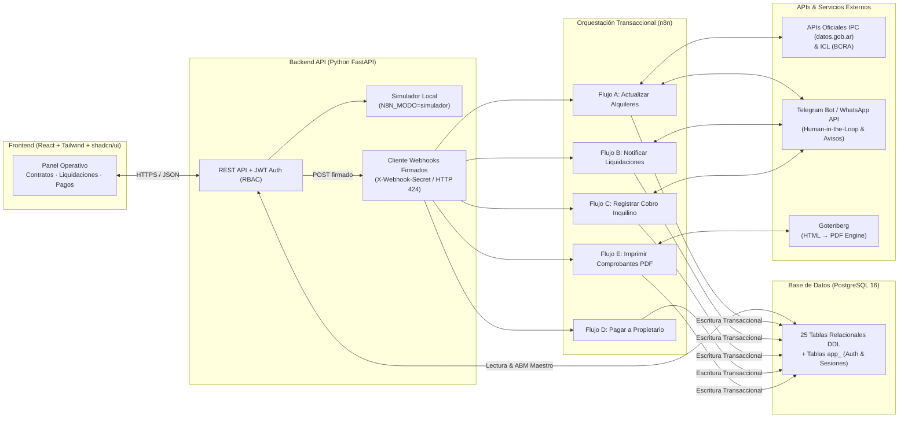

# ERP de Gestión de Alquileres & Motor de Automatización Transaccional

> **Caso de Estudio de Ingeniería (Forward Deployed Engineering):** Modernización integral de un sistema legacy (Visual FoxPro 6 + planillas de Excel) hacia una arquitectura web desacoplada con **Python (FastAPI)**, **React**, **PostgreSQL (25 tablas DDL)** y **5 flujos transaccionales en n8n** con aprobación *Human-in-the-Loop*, integración con APIs oficiales de índices económicos (IPC / ICL) y emisión automatizada de comprobantes PDF con **Gotenberg**.

---

## 1. El Problema de Negocio

La administración mensual de más de **130 contratos de alquiler** operaba sobre un sistema de escritorio en **Visual FoxPro 6 (tablas `.DBF` del año 2014)** combinado con planillas manuales de Excel.

Esto generaba cuatro cuellos de botella críticos todos los meses:
1. **Ajustes por inflación manuales y propensos a error:** consultar a mano los índices **IPC (INDEC)** e **ICL (BCRA)** según la cláusula de cada contrato (trimestral, cuatrimestral o semestral) y recalcular montos uno por uno.
2. **Cruce manual de impuestos y servicios:** cargar boletas de **EPE (luz), Agua, Gas y TGI (municipal)** con porcentajes prorrateados y números de partida/medidor para cada unidad.
3. **Desacople entre cobros a inquilinos y liquidaciones a propietarios:** falta de trazabilidad unificada entre lo cobrado al inquilino, las deducciones/comisiones de administración y el pago neto al propietario.
4. **Emisión y envío manual de recibos:** generación individual de comprobantes y envío manual por mensajería.

---

## 2. Arquitectura de la Solución

Se diseñó una arquitectura con **separación estricta de responsabilidades (CQRS pragmático)**:
- **La aplicación web (`FastAPI + React`)** gestiona el catálogo maestro (personas, propiedades, contratos, conceptos, configuración, auditoría de las 25 tablas DDL y control de acceso por roles `Admin` / `Operadora`).
- **Las tablas transaccionales críticas** (`pagos_inquilinos`, `pagos_propietarios`, `historial_de_actualizaciones`, `comunicaciones`, `comunicaciones_externas`) **se escriben exclusivamente a través de workflows transaccionales en n8n**, invocados por webhooks firmados (`X-Webhook-Secret`).
- **Entorno dual (`N8N_MODO=simulador | real`):** el backend cuenta con un simulador determinístico (`backend/core/n8n_simulador.py` + `pdf_simulado.py`) que permite ejecutar pruebas de integración completas (`pytest`) y entrenamientos operativos sin tocar servicios externos.



---

## 3. Los 5 Flujos Transaccionales en n8n (`n8n_workflows/`)

| Flujo | Archivo | Disparador / Endpoint | Qué resuelve |
| :--- | :--- | :--- | :--- |
| **A** | `A_actualizar-alquileres.json` | `POST /webhook/actualizar-alquileres` | Detecta contratos que cumplen ciclo de ajuste, consulta las APIs públicas de **IPC** e **ICL**, calcula el nuevo canon locativo y envía una tarjeta de aprobación **Human-in-the-Loop** por Telegram antes de impactar el cambio en PostgreSQL. |
| **B** | `B_notificar-liquidaciones.json` | `POST /webhook/notificar-liquidaciones` | Consolida la liquidación mensual (alquiler + impuestos/servicios cargados), formatea el desglose por contrato y envía el aviso al inquilino registrando la trazabilidad en `comunicaciones`. |
| **C** | `C_registrar-cobro.json` | `POST /webhook/registrar-cobro` | Registra el pago del inquilino (`id_liquidacion`, `fecha_pago`), actualiza el estado contable de la liquidación y dispara la confirmación de cobro. |
| **D** | `D_pagar-propietario.json` | `POST /webhook/pagar-propietario` | Liquida el neto al propietario descontando honorarios de administración y gastos a su cargo, impactando en `pagos_propietarios`. |
| **E** | `E_imprimir-comprobantes.json` | `POST /webhook/imprimir-comprobantes` | Compila las plantillas HTML de recibos para el período seleccionado y las procesa mediante **Gotenberg** para devolver un PDF unificado listo para impresión o envío. |

---

## 4. Stack Tecnológico

- **Frontend (`frontend/`):** React 18, Tailwind CSS, Radix UI / `shadcn/ui`, React Router, Axios con manejo centralizado de sesiones.
- **Backend (`backend/`):** Python, FastAPI, Uvicorn, `psycopg` (PostgreSQL), JWT (`PyJWT`) + cookies `HttpOnly`, `bcrypt`, `reportlab` (generación local de PDF en modo simulador), suite completa de tests por etapas (`backend/tests/test_etapa2.py` a `test_etapa7_8.py`).
- **Base de Datos:** PostgreSQL (25 tablas DDL de dominio inmobiliario + 3 tablas `app_*` de seguridad y auditoría de accesos).
- **Automatización & Infraestructura:** n8n, Gotenberg (conversión HTML a PDF en contenedor Docker), Docker Compose, APIs públicas de índices económicos (`apis.datos.gob.ar` y BCRA/ICL).

---

## 5. Estructura del Repositorio

```text
├── backend/
│   ├── core/                 # Auth JWT, conexión PostgreSQL, cliente n8n, simulador local y validaciones
│   ├── routes/               # Endpoints REST (contratos, liquidaciones, pagos, actualizaciones, propiedades, personas, etc.)
│   ├── tests/                # Suite de tests automatizados (Etapas 2 a 8)
│   ├── server.py             # Punto de entrada FastAPI
│   ├── requirements.txt      # Dependencias Python
│   └── .env.example          # Plantilla de variables de entorno (sin secretos)
├── frontend/
│   ├── src/
│   │   ├── components/       # Tabla de datos, diálogos, selectores, layout y componentes shadcn/ui
│   │   ├── pages/            # Módulos: Dashboard, Contratos, Liquidaciones, Actualizaciones, Pagos, Impresión, Configuración
│   │   ├── context/          # AuthContext y control de sesión
│   │   └── lib/              # Cliente API, validaciones de negocio y formateadores
│   ├── package.json
│   └── .env.example
├── n8n_workflows/            # Definiciones JSON sanitizadas de los 5 flujos de n8n (A–E)
└── docs/
    └── index.html            # Presentación interactiva de arquitectura y flujos (GitHub Pages)
```

---

## 6. Ejecución Local (Modo Simulador)

El proyecto puede levantarse localmente con `N8N_MODO=simulador` sin necesidad de exponer webhooks externos:

```bash
# 1. Backend (FastAPI en puerto 8001)
cd backend
cp .env.example .env
python3 -m venv .venv && source .venv/bin/activate
pip install -r requirements.txt
uvicorn server:app --port 8001 --reload

# 2. Frontend (React en puerto 3001)
cd ../frontend
cp .env.example .env
yarn install
PORT=3001 yarn start
```
